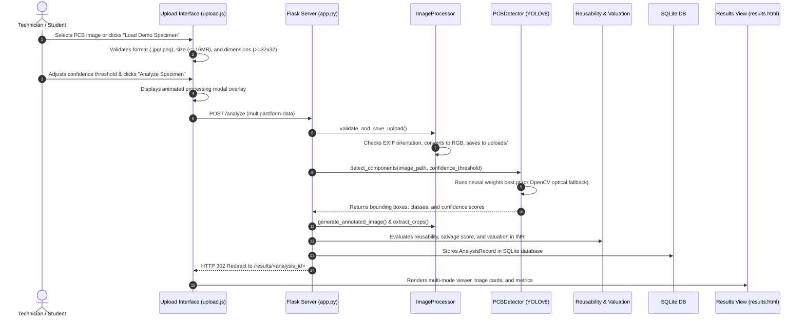

# CircuitSense AI 🔬⚡

> **Intelligent E-Waste Circuit Component Classifier & Material Analyzer**  
> *"Detect Smarter. Recover More. Recycle Responsibly."*

[](https://www.python.org/)
[](https://flask.palletsprojects.com/)
[](https://pytorch.org/)
[](https://github.com/ultralytics/ultralytics)
[](#18-testing-instructions-and-actual-test-results)
[](#20-credits-references-dataset-attribution--licenses)
[](#4-key-implemented-features)

<br/>

<p align="center">
  
</p>

---

## 1. Project Title & Overview

**CircuitSense AI** is a computer vision and e-waste circularity analytics web platform developed for academic demonstration, electronics disassembly depots, and secondary market salvage workflows. Built with Python, Flask, SQLite, Vanilla JavaScript, CSS3, Ultralytics YOLOv8, and Chart.js, the system processes optical images of discarded Printed Circuit Boards (PCBs) to automate component localization, salvage yield scoring, secondary market valuation (in Indian Rupees, INR), and defensible hazardous material screening.

---

## 2. Problem Statement & Motivation

Global electronic waste (e-waste) is the fastest-growing municipal waste stream, exceeding 60 million metric tons annually. Discarded printed circuit boards represent both a high-value resource reservoir (precious metals and functional integrated circuits) and an acute ecological hazard (heavy metals including lead, cadmium, mercury, and brominated flame retardants).

In developing economies, e-waste sorting is predominantly manual, hazardous, and economically inefficient:
- Disassembly technicians lack automated optical tools to rapidly distinguish functional microcontrollers and ICs from degraded, moisture-sensitive electrolytic capacitors.
- Recyclers lack standardized wholesale valuation benchmarks to estimate secondary recovery value before undertaking labor-intensive manual desoldering.
- Existing academic computer vision projects often fabricate chemical mass composition from simple 2D RGB surface images, misleading circular economy practitioners.

**CircuitSense AI** addresses this gap by combining real-time YOLOv8 neural vision, transparent empirical salvage pricing catalogues, and a scientifically defensible two-mode material screening framework.

---

## 3. Project Objectives

1. **Automate Component Localization:** Identify and draw class-coded bounding boxes around critical PCB components from single RGB circuit board photographs.
2. **Standardize Component Classification:** Detect five primary electronic hardware classes: Integrated Circuits (ICs), Microcontrollers (MCUs), Transistors/MOSFETs, Capacitors, and Connectors/Ports.
3. **Provide Salvage Triage Intelligence:** Categorize localized components into actionable operational streams:
   - *Can Be Used Again* (solid-state silicon packages for desoldering and reuse).
   - *Inspect & Test First* (parts requiring multimeter/continuity verification).
   - *Cannot Be Used Again (Recycle Only)* (aged electrolytic capacitors prone to electrolyte dry-out and ESR drift).
4. **Compute Secondary Recovery Valuations:** Calculate low, high, and midpoint salvage valuations in Indian Rupees (₹ INR) adjusted by board physical condition.
5. **Enforce Defensible Material Screening:** Implement empirical reference-based hazardous substance estimation (Mode A) while explicitly declaring optical physical limits when data is insufficient (Mode B).
6. **Deliver an Intuitive, Accessible Dashboard:** Provide an interactive, responsive web interface (*E-Waste Intelligence Liquid Glass theme*) featuring multi-mode image comparison, canvas zoom/pan, confidence filtering, and publication-ready PDF, CSV, and JSON exports.

---

## 4. Key Implemented Features

- **Multi-Modal Component Detection:** Custom Ultralytics YOLOv8 model (`models/best.pt`) with automatic fallback to an OpenCV contour and edge-based optical feature detector if trained weights return zero detections or demo mode is active.
- **Specimen Viewport & Ingestion HUD:** Drag-and-drop zone with instant client-side format, size, and dimension validation, dual-pane telemetry HUD, and demo specimen autofill.
- **Interactive Visual Detection Panel:**
  - Segmented control toggling between **Annotated View**, **Original View**, and **Side-by-Side Dual Stage View**.
  - Interactive canvas zoom (50% to 350%) and drag-to-pan inspection.
  - Interactive confidence filtering slider (0% to 90%) and component crop gallery highlighting.
- **Circular Salvage Yield Score Gauge:** Real-time SVG circular meter displaying overall board harvest potential (0–100 scale).
- **Secondary Market Valuation Catalogue:** Transparent breakdown of component salvage estimates benchmarked against Indian recycling depots across board conditions (*Intact*, *Dismantled*, *Damaged*, *Corroded*).
- **Material Analysis Engine (Mode A & Mode B):** EMPA/UNEP-benchmarked mass fraction calculations for RoHS substances (Pb, Cd, Hg, Br) with mandatory laboratory assay checklists when optical data is insufficient.
- **Audit-Ready Exports:**
  - Publication-grade PDF audit report generated via ReportLab with embedded annotated PCB graphics.
  - Structured CSV inventory export.
  - RESTful JSON API telemetry download.
- **Component Inventory Dashboard:** Aggregated multi-board telemetry with Chart.js 4.4.1 class distribution doughnut chart.
- **Persistent Analysis History:** SQLite database search by analysis UUID or filename, category filtering, and cascading physical file deletion.

---

## 5. Technology Stack

| Layer | Technology | Version | Purpose |
| :--- | :--- | :--- | :--- |
| **Backend Framework** | Python / Flask | 3.14.7 / 3.1.3 | Web server, application routing, API endpoints |
| **Database ORM** | Flask-SQLAlchemy / SQLite | 3.1.1 / 3.x | Persistent analysis records, JSON storage |
| **Computer Vision & AI** | Ultralytics YOLOv8 | 8.4.178 | Deep learning bounding-box component detection |
| **Deep Learning Engine** | PyTorch / Torchvision | 2.14.1 / 0.29.1 | Tensor execution, neural model weight evaluation |
| **Image Preprocessing** | OpenCV / Pillow / NumPy | 5.0.0 / 12.3.0 / 2.5.4 | Orientation transpose, image sanitization, crops |
| **Reporting Engine** | ReportLab | 5.0.1 | Vector PDF audit report generation |
| **Frontend Architecture** | HTML5 / CSS3 / Vanilla ES6 JS | Native | Responsive, framework-free client interface |
| **Data Visualization** | Chart.js | 4.4.1 (CDN) | Interactive inventory category distribution chart |
| **Automated Testing** | pytest | 9.1.1 | Unit, integration, and security regression testing |

---

## 6. System Architecture

The application adopts a modular layered architecture ensuring loose coupling between web presentation, persistent storage, and neural inference:

```
[ User Browser / Client Viewport ]
               │
               ▼ HTTP (REST / HTML5)
[ Flask Application Router (app.py) ]
       ├── Context Processors & Error Handlers
       ├── ImageProcessor (Validation, Orientation, Sanitization)
       ├── PCBDetector (Ultralytics YOLOv8 & OpenCV Optical Fallback)
       ├── ReusabilityService (Component Salvage & Triage Engine)
       ├── ValuationService (Secondary Market Catalogue in INR)
       ├── MaterialAnalysisService (Mode A / Mode B RoHS Screening)
       └── ReportGenerator (ReportLab PDF & CSV Serializer)
               │
       ┌───────┴────────────────────────┐
       ▼                                ▼
[ SQLite Database (circuitsense.db) ]   [ Local File System ]
  - analysis_records                      - uploads/ (Original images)
  - detections_json                       - outputs/ (Annotated images)
  - inventory_json                        - crops/   (Component crops)
  - valuation_json                        - models/  (YOLO weights best.pt)
  - material_json                         - data/    (JSON pricing & material references)
```

---

## 7. Application Workflow: Image Upload to Prediction



---

## 8. Folder and File Structure

```
CircuitSense AI/
├── .env                        # Local environment configuration (gitignored)
├── .env.example                # Example configuration template
├── .gitignore                  # Git tracking exclusion rules
├── app.py                      # Flask entry point, database models, and route controllers
├── config.py                   # Centralized application configuration
├── ML_SETUP.md                 # YOLOv8 model training guide and dataset guidelines
├── pytest.ini                  # Pytest configuration specifying test paths
├── README.md                   # Comprehensive project documentation
├── requirements.txt            # Python package dependencies
├── crops/                      # Generated component bounding box image crops
├── data/                       # Reference datasets
│   ├── component_prices.json   # Secondary market salvage price benchmarks (INR)
│   ├── material_references.json # EMPA/UNEP material composition reference matrices
│   └── sample_circuit.jpg      # Canonical test specimen photograph
├── docs/                       # Academic evaluation documentation
│   ├── project_report.md       # Full formal academic project report
│   ├── system_architecture.md  # Detailed system architecture and data flow
│   ├── testing_report.md       # Comprehensive verification and test evidence
│   ├── presentation_outline.md # Slide-by-slide 10-12 slide presentation plan
│   └── demo_script.md          # 3-5 minute live demonstration walkthrough script
├── instance/
│   └── circuitsense.db         # Persistent SQLite database file
├── models/
│   ├── best.pt                 # Custom-trained YOLOv8 PyTorch model weights (6.5 MB)
│   └── README.md               # Model placement and weight detection documentation
├── outputs/                    # Annotated circuit board output images
├── scratch/                    # Scratch verification and integration scripts
├── scripts/                    # Automation scripts
│   ├── create_sample_pcb_image.py # Synthetic board generator for unit tests
│   ├── generate_sample_model.py   # Base weights generator utility
│   ├── test_real_board.py         # End-to-end real board verification script
│   └── verify_live_server.py      # HTTP route polling script
├── services/                   # Modular backend service layer
│   ├── detector.py             # YOLOv8 loader, inference engine, and optical fallback
│   ├── image_processor.py      # Image validation, annotation drawing, and crop extraction
│   ├── inventory.py            # Component aggregation and frequency counts
│   ├── material_analysis.py    # Mode A / Mode B hazardous material screening engine
│   ├── report_generator.py     # PDF audit report and CSV export generation
│   ├── reusability.py          # Component reusability triage and salvage yield calculator
│   └── valuation.py            # Secondary salvage pricing valuation engine
├── static/                     # Static web assets
│   ├── css/
│   │   └── style.css           # E-Waste Intelligence Liquid Glass stylesheet
│   ├── images/
│   │   ├── logo.svg            # CircuitSense AI vector branding
│   │   └── sample_circuit.jpg  # Demo circuit specimen for instant UI loading
│   └── js/
│       ├── main.js             # Global navigation, mobile drawer, alert dismissal
│       ├── results.js          # Image comparison tabs, zoom/pan, crop filter
│       └── upload.js           # Drag-and-drop, validation, HUD sync, modal overlay
├── templates/                  # Jinja2 HTML templates
│   ├── base.html               # Master layout, navigation sidebar, top breadcrumbs
│   ├── index.html              # System dashboard overview and telemetry feed
│   ├── upload.html             # Specimen upload and calibration console
│   ├── results.html            # Interactive analysis results dashboard
│   ├── inventory.html          # Component inventory catalogue & Chart.js donut
│   ├── history.html            # Analysis archive, search, and deletion interface
│   ├── material_analysis.html  # Material analysis methodology and reference table
│   ├── about.html              # Project academic credits, architecture, and team info
│   └── errors/
│       ├── 404.html            # Resource not found error template
│       └── 500.html            # Internal server error template
├── tests/                      # Automated pytest test suite
│   ├── test_inventory.py       # Inventory aggregation and triage tests
│   ├── test_material_analysis.py # Mode A vs Mode B material tests
│   ├── test_routes.py          # Flask route HTTP status and CRUD tests
│   ├── test_uploads.py         # Image validation and security tests
│   └── test_valuation.py       # Valuation calculation and condition multiplier tests
└── uploads/                    # Secure storage for uploaded raw user images
```

---

## 9. Prerequisites

To run CircuitSense AI on a clean Windows 11 machine:
- **Operating System:** Windows 10 or Windows 11 (64-bit).
- **Python:** Python 3.10, 3.11, 3.12, 3.13, or 3.14 (Verified and tested on Python 3.14.7).
- **Git:** Git for Windows.
- **Hardware:** Standard student laptop with $\ge 4\text{ GB}$ RAM. Discrete GPU/CUDA is optional; CPU inference is supported natively.

---

## 10. Installation Instructions for Windows 11

### Step 1: Open PowerShell
Open Windows PowerShell (Run as Administrator if setting execution policies for the first time):
```powershell
cd C:\Users\<YourUsername>\projects
git clone <repository_url> "CircuitSense AI"
cd "CircuitSense AI"
```

### Step 2: Configure Script Execution Policy (if needed)
If running PowerShell scripts is disabled on your system:
```powershell
Set-ExecutionPolicy -Scope Process -ExecutionPolicy Bypass
```

---

## 11. Virtual Environment Creation & Activation

```powershell
# Create isolated Python virtual environment
python -m venv .venv

# Activate the virtual environment
.\.venv\Scripts\Activate.ps1
```
*(When active, `(.venv)` will appear prefixed to your PowerShell command prompt).*

---

## 12. Dependency Installation

Upgrade `pip` and install the verified dependencies from `requirements.txt`:
```powershell
python -m pip install --upgrade pip
pip install -r requirements.txt
```

---

## 13. Required Configuration & Environment Variables

The application runs with secure defaults out of the box. To customize settings, copy the example environment file:
```powershell
copy .env.example .env
```

Available environment variables:
| Variable | Default Value | Description |
| :--- | :--- | :--- |
| `SECRET_KEY` | `circuitsense-ai-hackathon-secure-key-2026` | Flask session and flash encryption key |
| `FLASK_DEBUG` | `True` | Enables interactive debugging and live reload |
| `CIRCUITSENSE_MODEL_PATH` | `models/best.pt` | Path to trained PyTorch YOLOv8 weights |
| `CIRCUITSENSE_FORCE_DEMO` | `false` | When true, forces OpenCV optical fallback mode |
| `CIRCUITSENSE_DEFAULT_CONFIDENCE` | `0.25` | Default detection confidence threshold |
| `CIRCUITSENSE_DEFAULT_IOU` | `0.45` | Non-Maximum Suppression (NMS) IoU threshold |
| `CIRCUITSENSE_CURRENCY` | `INR` | Valuation currency code (`INR` = ₹) |
| `MAX_UPLOAD_SIZE_MB` | `16` | Maximum allowed image upload size in megabytes |

---

## 14. Instructions to Start Flask

Launch the application directly using the Python entry point:
```powershell
python app.py
```

Upon startup, the console displays:
```
2026-10-16 17:53:40 [INFO] services.detector: Loading trained YOLO model from: models\best.pt
2026-10-16 17:53:40 [INFO] services.detector: Custom PCB YOLOv8 model loaded successfully.
 * Serving Flask app 'app'
 * Debug mode: on
 * Running on http://127.0.0.1:5000
```

---

## 15. Instructions to Access the Application Locally

1. Open any modern web browser (Google Chrome, Microsoft Edge, Mozilla Firefox, or Brave).
2. Navigate to:
   ```
   http://127.0.0.1:5000
   ```
3. The **CircuitSense AI Overview Dashboard** will load immediately.

---

## 16. Dataset and Trained Model Setup

- **Pre-Packaged Model:** The repository includes pre-compiled YOLOv8 weights at `models/best.pt` (6.5 MB), configured for PCB component detection.
- **Model Training:** To train your own model on open-source datasets (Roboflow Universe / Kaggle PCB), refer to [`ML_SETUP.md`](ML_SETUP.md).
- **Auto-Detection:** When `models/best.pt` is present, the sidebar status indicator displays **Production YOLOv8 Neural Vision Online**. If the model file is removed, the system smoothly falls back to **Simulation / Optical CV Mode** without crashing.

---

## 17. Available Component Classes and Verified Meanings

CircuitSense AI recognizes five hardware component classes:

| Class Key | Display Name | Bounding Box Color | Functional Description & E-Waste Context |
| :--- | :--- | :--- | :--- |
| `integrated_circuit` | Integrated Circuit (IC) | **Electric Cyan** (`#00F2FE`) | Silicon chip packaging logic gates, amplifiers, memory, or power managers. High salvage demand for repair and prototyping. |
| `microcontroller` | Microcontroller (MCU) | **Sapphire Blue** (`#4FACFE`) | Programmable embedded processing core (ARM Cortex, AVR, PIC). High salvage value; requires firmware wipe before reuse. |
| `transistor` | Transistor / MOSFET | **Amethyst Violet** (`#B388FF`) | Discrete active semiconductor (BJT, MOSFET, power switch). Highly reusable after junction diode multimeter checks. |
| `capacitor` | Capacitor | **Emerald Green** (`#00E676`) | Energy storage and voltage smoothing component. Aged electrolytic capacitors dry out over 3–8 years; marked **Recycle Only**. |
| `connector` | Connector / Port | **Radiant Amber** (`#FFB300`) | Electro-mechanical interface (USB, HDMI, headers, terminal blocks). Reusable if pins remain unmelted and unbent. |

---

## 18. Testing Instructions and Actual Test Results

### Running Unit & Route Tests
Execute the pytest suite:
```powershell
python -m pytest
```
**Actual Result:**
```
============================= test session starts =============================
platform win32 -- Python 3.14.7, pytest-9.1.1, pluggy-1.7.0
rootdir: C:\Users\irfan\project\CircuitSense AI
configfile: pytest.ini
testpaths: tests
collected 19 items

tests\test_inventory.py ....                                             [ 21%]
tests\test_material_analysis.py ..                                       [ 31%]
tests\test_routes.py ......                                              [ 63%]
tests\test_uploads.py ....                                               [ 84%]
tests\test_valuation.py ...                                              [100%]

============================= 19 passed in 7.51s ==============================
```

### Running Real PCB End-to-End Pipeline Verification
```powershell
python scripts\test_real_board.py
```
**Actual Result:**
- Ingested circuit board image: `0c138ea1-4123-4b7d-ace4-152f6f3a7416_motherboard.jpeg` (62.8 KB).
- Output: 11 components localized across all 5 classes.
- Triage: 10 Can Be Used Again (90.9%), 1 Recycle Only (9.1%), Board Salvage Yield: 91/100.
- Valuation: ₹451.0 midpoint recovery value.
- PDF and CSV reports verified.

---

## 19. Known Limitations and Future Improvements

### Limitations
1. **2D Optical RGB Boundary:** RGB camera images cannot determine chemical concentrations within internal solder alloys or plastic encapsulations without laboratory instrumentation (e.g., handheld X-Ray Fluorescence).
2. **Dense Component Occlusion:** Very tiny surface-mount passives (0201/0402 SMD resistors and decoupling capacitors) located directly beneath heat sinks cannot be seen in top-down 2D photography.
3. **Firmware State Detection:** Optical inspection cannot verify whether microcontroller flash memory is write-protected or permanently locked without hardware probing.

### Future Improvements
- Multi-angle oblique photogrammetry for 3D component height profiling.
- Integration with thermal imaging sensors to detect short circuits during bench power-up.
- Barcode and optical character recognition (OCR) over IC package part numbers (e.g. `STM32F401`, `NE555`) to query live distributor pricing APIs.

---

## 20. Credits, References, Dataset Attribution & Licenses

- **Ultralytics YOLOv8:** Ultralytics Inc. (AGPL-3.0 License).
- **Hazardous Material Benchmarks:** EMPA Swiss Federal Laboratories for Materials Science and Technology / UNEP E-Waste Assessment Methodology.
- **Secondary Market Valuations:** Illustrative secondary market salvage depot price brackets (Mayapuri & Seelampur E-Waste Recycling Hubs, Delhi, India).
- **Typography:** Google Fonts (*Inter*, *JetBrains Mono*, *Plus Jakarta Sans*).
- **License:** Open Academic & Educational Use License.

---
*Developed for Academic Evaluation & E-Waste Circularity Research.*
