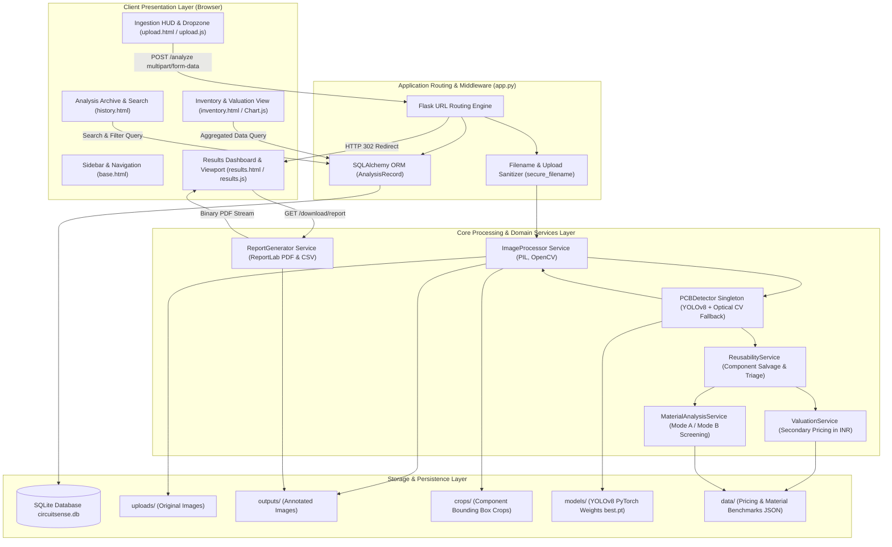
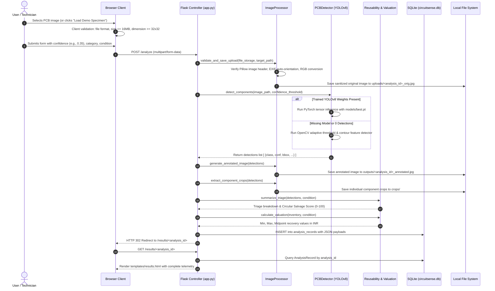
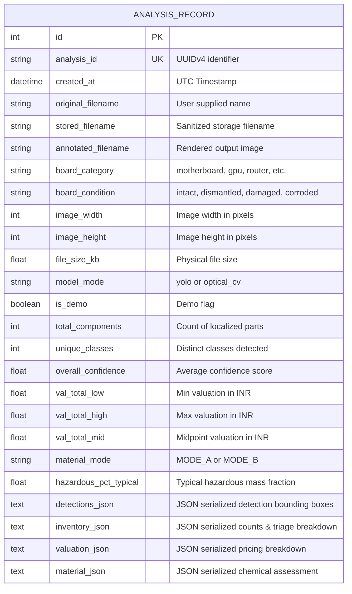

# CircuitSense AI: System Architecture & Data Flow Specification

This document provides a comprehensive architectural and engineering blueprint of **CircuitSense AI**, detailing the structural layers, module interactions, data flows, and database interactions of the deployed system.

---

## 1. Architectural Overview

CircuitSense AI follows a modular, layered service-oriented architecture (SOA) built upon Flask (Python 3.14 / WSGI). The design prioritizes loose coupling, local execution capability, deterministic fallback behavior, and defensible data separation.

---

## 2. Frontend Layer Architecture

The frontend is constructed with Vanilla HTML5, CSS3, and ES6 JavaScript, without third-party frontend frameworks:
- **Design Tokens & Theme:** Handcrafted *E-Waste Intelligence Liquid Glass* theme featuring deep obsidian surfaces (`#121316`, `#181A20`, `#1F222A`), subtle ambient light orbs, semi-transparent frosted glass panels (`backdrop-filter: blur(16px)`), and precise 1px cyan-tinted borders.
- **`static/js/upload.js`:** Manages the dropzone drag-over/drop listeners, enforces file-type/size/dimension validation, triggers sample specimen autofill via `fetch()` and `DataTransfer`, syncs HUD status coordinates, and displays the animated progress overlay upon form submission.
- **`static/js/results.js`:** Controls view mode tab switching between Annotated, Original, and Side-by-Side dual stage; executes matrix translation/scaling for canvas zoom (50% to 350%) and drag-to-pan; and applies compound client-side filtering over confidence thresholds and reusability categories.
- **`static/js/main.js`:** Handles mobile drawer toggling (`#mobileMenuBtn` and `#appSidebar`), off-canvas dismissals, and auto-dismissing flash notifications.
- **Chart.js 4.4.1 (CDN):** Visualizes component class distribution as a responsive doughnut chart on the Component Inventory page with a centered total units overlay.

---

## 3. Application Controller & Routing Layer (`app.py`)

The Flask application acts as the coordinator between incoming client requests, business logic services, and the database:

### Core Routes Summary
| HTTP Method | Route | Description | Template / Output |
| :--- | :--- | :--- | :--- |
| `GET` | `/` | Overview Dashboard with system metrics and recent scans | `index.html` |
| `GET`, `POST` | `/analyze` | Upload console (GET) and analysis ingestion pipeline (POST) | `upload.html` / Redirect |
| `GET` | `/results/<analysis_id>` | Interactive Results Dashboard for a specific analysis | `results.html` |
| `GET` | `/inventory` | Component inventory summary & valuation catalogue | `inventory.html` |
| `GET` | `/history` | Historical archive with search query and category filters | `history.html` |
| `GET` | `/material-analysis` | Material analysis knowledge base and scientific methodology | `material_analysis.html` |
| `GET` | `/about` | Project background, academic credits, and architecture | `about.html` |
| `GET` | `/download/report/<id>` | Generates and streams publication-ready PDF report | `application/pdf` |
| `GET` | `/download/csv/<id>` | Generates and streams structured component CSV inventory | `text/csv` |
| `GET` | `/download/json/<id>` | Exports full structured detections and valuation as JSON | `application/json` |
| `POST` | `/delete/<analysis_id>` | Deletes database record and cascades unlinks for image files | Redirect to `/history` |
| `GET` | `/uploads/<filename>` | Serves raw uploaded original PCB photographs safely | Image file |
| `GET` | `/outputs/<filename>` | Serves generated annotated PCB images safely | Image file |
| `GET` | `/crops/<filename>` | Serves extracted component-level crops safely | Image file |

---

## 4. Detailed Data Flow: Image Ingestion to Report Generation

---

## 5. Domain Service Layer Design

### 5.1 ImageProcessor (`services/image_processor.py`)
- **Sanitization & Orientation:** Reads raw binary streams, validates image headers using Pillow, and corrects mobile phone orientation using `ImageOps.exif_transpose`.
- **Annotation Graphics:** Uses OpenCV (`cv2`) to draw class-colored bounding box borders, darkened corner reticles, confidence text badges, and anti-aliased labels.
- **Crop Extraction:** Slices localized sub-regions with a 5% margin, saves them as individual JPEG crops into `crops/`, and appends the relative URL to each detection object.

### 5.2 PCBDetector (`services/detector.py`)
- **Singleton Caching:** Implements the Singleton pattern to load the YOLOv8 PyTorch model into memory once, eliminating multi-second reload latency on subsequent HTTP requests.
- **Target Classes & Aliasing:** Standardizes raw model predictions into five canonical classes:
  - `integrated_circuit` (ICs)
  - `microcontroller` (MCUs)
  - `transistor` (Transistors/MOSFETs)
  - `capacitor` (Capacitors)
  - `connector` (Connectors/Ports)
- **Optical Contour Fallback:** If the YOLO model returns zero detections (e.g. non-standard lighting or camera glare), the detector automatically executes Gaussian blur, Otsu adaptive thresholding, and morphological contour filtering to locate components optically.

### 5.3 ReusabilityService (`services/reusability.py`)
- **Operational Triage:** Applies electronic hardware physics to categorize components:
  - *Can Be Used Again:* Solid-state silicon logic (ICs, MCUs, Transistors) that withstand controlled desoldering ($< 245^\circ\text{C}$).
  - *Inspect & Test First:* Connectors and power switching devices requiring pin continuity and gate insulation checks.
  - *Cannot Be Used Again (Recycle Only):* Aged aluminum electrolytic capacitors. Liquid electrolyte dries out over 3–8 years, leading to high Equivalent Series Resistance (ESR) drift, dielectric breakdown, and blowout hazard.
- **Board Salvage Yield Score:** Computes a composite 0–100 index weighted by component reusability, confidence scores, and physical board condition.

### 5.4 ValuationService (`services/valuation.py`)
- Reads baseline secondary market price tables from `data/component_prices.json`.
- Applies physical condition multipliers:
  - Intact: $1.0\times$
  - Dismantled: $0.85\times$
  - Damaged: $0.40\times$
  - Corroded: $0.20\times$
- Aggregates component quantities to compute low, high, and midpoint recoverable totals in INR.

### 5.5 MaterialAnalysisService (`services/material_analysis.py`)
- **Mode A (Reference-Based Estimation):** Activated when the circuit board category (e.g. motherboard, GPU, phone, router) matches empirical EMPA/UNEP characterization matrices, calculating typical mass fractions for heavy metals (lead, cadmium, mercury) and precious metals.
- **Mode B (Insufficient Data Protocol):** Activated when the board is unclassified or generic. Explicitly informs the user that 2D optical RGB photography cannot penetrate component encapsulation to quantify chemical concentrations, prompting for handheld XRF spectrometry.

### 5.6 ReportGenerator (`services/report_generator.py`)
- Uses ReportLab's flowable vector engine to generate audit-ready PDF documents featuring a custom header banner, key summary metrics, an embedded high-resolution annotated circuit board image, a component triage inventory table, and environmental compliance disclaimers.
- Compiles structured CSV records including Component Number, Class, Confidence, Reusability Recommendation, Action Required, and Bounding Box coordinates.

---

## 6. Persistence & SQLite Schema

Data is stored locally in `instance/circuitsense.db` using SQLite:

---

## 7. Security Architecture & Defensive Design

1. **Path Traversal Protection:**
   - User-supplied filenames are never used directly as file system paths. `werkzeug.utils.secure_filename` is strictly enforced upon ingestion and on file-serving routes (`/uploads/<filename>`, `/outputs/<filename>`, `/crops/<filename>`).
2. **Payload Size Restrictions:**
   - Server enforces `MAX_CONTENT_LENGTH = 16 * 1024 * 1024` (16 MB). Oversized requests are rejected with HTTP 413 (`RequestEntityTooLarge`) before memory exhaustion can occur.
3. **Decoupled Execution:**
   - The application does not execute arbitrary shell commands or user-supplied strings. All queries use parameterized SQLAlchemy calls to prevent SQL injection.
4. **Graceful Exception Recovery:**
   - If model inference or image processing encounters an exception, uncommitted database sessions are rolled back, temporary upload files are unlinked, and the user is redirected with an informative flash error notification.
